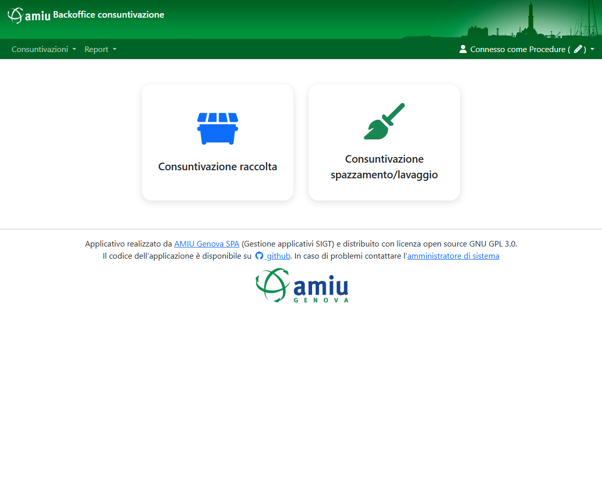

Accesso
================================

Utenti
------------------------------------------------------------

Tutti gli utenti sia interni che esterni accedono al sistema utilizzando le credenziali aziendali.

Per quelli interni sono le credenziali con cui si accede al proprio PC aziendale.
Per queli esterni si tratta delle credenziali fornite da AMIU. 

Per gli utenti interni è anche possibile accedere direttamente dal SIT: 

- Collegamenti

   - Nuova dashboard totem

Per la sicurezza, è consigliabile uscire dal sistema al termine dell'uso e
non condividere le credenziali con altri utenti.

Ogni utente è associato ad alcune Unità Territoriali secondo quanto configurato sul SIT. 
Per modificare le impostazioni è necessario che il proprio referente contatti i colleghi di  *assterrritorio*

Una volta entrati si visualizza la pagina principale. 

Menù
------------------------------------------------------------

Nel menù in alto compaiono 2 voci principali e le impostazioni dell'utente

- **consuntivazioni** da cui si può accedere alla consuntivazione dei percorsi di raccolta e di igiene del suolo (spazzamento, lavaggio e simili)
- **report** da cui si può accedere a 2 report: 
   - *Associazione ai servizi*
   - *Carburante*
- utente con cui si è effettuato il login: cliccandoci sopra è possibile visualizzare le UT o Rimesse a cui è associrato l'utente ed effettuare il logout dall'applicativo

Bottoni principali
------------------------------------------------------------

Sono anche presenti 2 bottoni con i quali si accede alle principali funzioni per la: 

- consuntivazione percorsi di raccolta
- consuntivazione percorsi di igiene del suolo (spazzamento, lavaggio e simili)