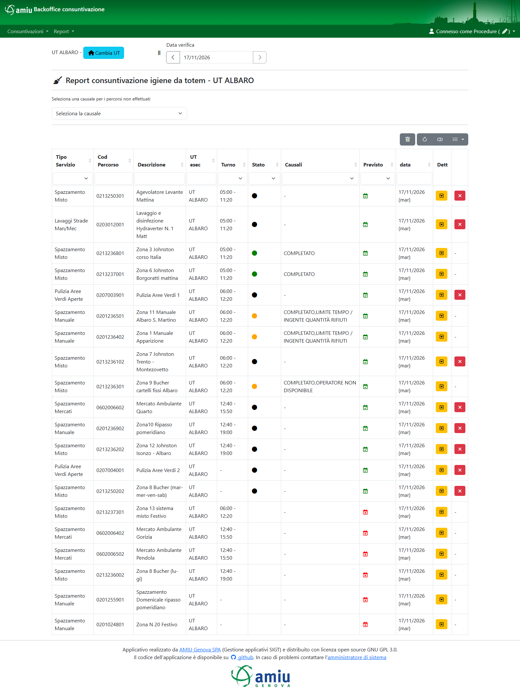

Consuntivazione Igiene
===============================

Se l'utente avesse accesso ad una sola UT e/o Rimessa visualizzerebbe direttamente la pagina in cui sono visibili tutti i percorsi di quella UT

In caso contrario come prima opzione è necessario selezionare l'UT 

.. image:: img/cons_racccolta/scelta_ut.png
    :align: center

Una volta selezionata l'UT nella seconda pagina vengono visualizzati tutti i percorsi di **raccolta** di quella UT o Rimessa (nell'esempio quelli di UT Albaro).

In alto è possibile: 

- cambiare UT 
- modificare il giorno (fino ad un massimo di 7 giorni indietro)
- selezionare una causale con cui eseguire automaticamente i percorsi come non effettuati cliccando, se abilitati, sull'apposito tasto presente a fianco del percorso

In prima battuta vengono visualizzati i percorsi previsti per quel giorno. Successivamente quelli non previsti. Nel campo *stato*, per ogni percorso *previsto* compare un pallino che può assumere 4 colori: 

- **nero**: non consuntivato
- **verde**: consuntivato come completato
- **giallo**: consuntivato come non completato (alcune tappe non effettuate)
- **rosso**: consuntivato come non effettuati (tutte le tappe sono non completate)

cliccando sul tasto giallo si accede invece ai dettagli della consuntivazione da cui è anche possibile modificare la consuntivazione stessa.